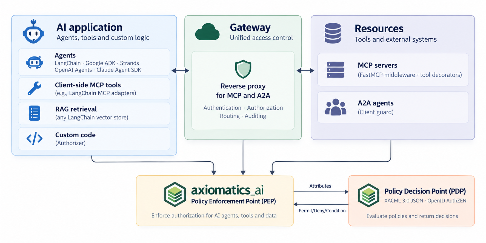
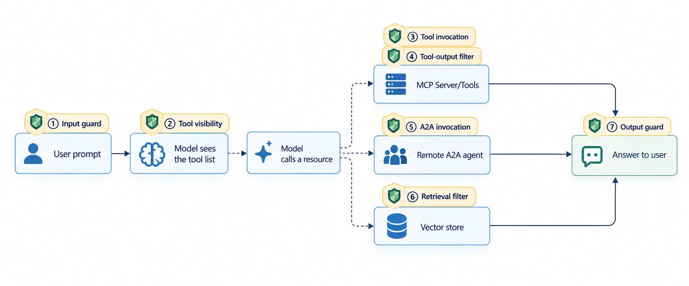

# axiomatics-ai-sdk-python

**Externalized attribute-based access control (ABAC) for AI applications.**

Agents decide what to do; this SDK decides what they are *allowed* to do, by asking a Policy
Decision Point (PDP) at every point where an agent turn touches something that matters: the
prompt, the tool list, each tool call, each tool result, the final answer, agent-to-agent
messages, and document retrieval. Policies live in the PDP, written once in a standard policy
language, and apply the same way across LangChain, Google ADK, Strands, OpenAI Agents, the
Claude Agent SDK, MCP servers, A2A agents, and your own code. No authorization logic in the
application.

The SDK speaks **XACML 3.0 JSON** and **OpenID AuthZEN**, so it works with any PDP that
implements either. It is developed and tested against [Axiomatics ADS](docs/running-ads.md).

## Where it fits

Every block below talks to the PDP through the SDK, which plays the Policy Enforcement Point
(PEP): it builds the authorization request from the caller's identity and the thing being
attempted, asks the PDP, and applies the answer.



## When it intercepts

Along one agent turn the SDK can intercept at seven points. Each is a *transformation* of what
flows through it; a Deny is the simplest case (block, hide, or filter).




| # | Point | Fires | On Deny | Decided by |
|---|---|---|---|---|
| ① | Input guard (`BEFORE_MODEL`) | before the model sees the prompt | prompt blocked, refusal returned | policy over LLM-classified attributes |
| ② | Tool visibility (`TOOL_VISIBILITY`) | before the model sees the tool list | tool hidden; the model never knows it exists | policy |
| ③ | Tool invocation (`BEFORE_TOOL`) | before a tool call runs | call blocked; arguments are part of the decision; or paused for a [human's approval](docs/human-approval.md) | policy, optionally against the user's [classified intent](docs/intent-based-access.md) |
| ④ | Tool-output filter (`AFTER_TOOL`) | after a tool returns | denied records dropped, or fields masked | policy, per record |
| ⑤ | Output guard (`AFTER_MODEL`) | before the answer reaches the user | answer blocked, refusal returned | policy over LLM-classified attributes |
| ⑥ | A2A invocation (`A2A_INVOCATION`) | on an agent-to-agent message | message blocked | policy |
| ⑦ | Retrieval filter (`retrieval`) | on a vector-store search | only permitted documents returned; the filter is pushed into the store | policy, as a condition |

## Quick start

```bash
pip install "axiomatics-ai-sdk[langchain-agents]" langchain-litellm   # or: uv add ...
```

`langchain-litellm` is only the model this example uses; bring any LangChain chat model.

Wrap a LangChain agent. The context dict is the user's identity; the PDP decides which tools
alice sees, which calls run, and which records come back.

```python
from langchain.tools import tool
from langchain_litellm import ChatLiteLLM
from axiomatics_ai import AuthZConfig, PDPConnection, create_authorized_agent, standard_tool_enforcement

@tool
def search_docs(query: str) -> str:
    """Search internal documentation."""
    return "..."

config = AuthZConfig(
    connection=PDPConnection(base_url="http://localhost:8080"),
    enforcement=standard_tool_enforcement(),   # tool visibility + invocation + output filter
)

agent = create_authorized_agent(
    model=ChatLiteLLM(model="openai/gpt-5.6-luna"),
    tools=[search_docs],
    config=config,
)

agent.invoke({"messages": [{"role": "user", "content": "Find docs on deployment"}]},
             context={"username": "alice"})
```

No framework? Ask the PDP directly and enforce yourself (same `config`):

```python
from axiomatics_ai import Authorizer

authz = Authorizer(config)
if not authz.is_permitted(action="read_document", resource="doc-42", context={"username": "alice"}):
    raise PermissionError
```

Every other framework has a one-call equivalent; see [Integrations](docs/README.md#integrations).
Full walkthrough, including running a PDP and writing the first policy:
[Getting started](docs/getting-started.md).

## What it covers

Not every framework exposes a hook at every point. ✅ supported · — not expressible there.

| Integration | Input guard | Tool visibility | Tool invocation | Output filter | Output guard | Retrieval | A2A | Side |
|---|:-:|:-:|:-:|:-:|:-:|:-:|:-:|---|
| [langchain_agents](docs/integrations/langchain_agents.md) | ✅ | ✅ | ✅ | ✅ | ✅ | — | — | client |
| [google_adk](docs/integrations/google_adk.md) | ✅ | ✅ | ✅ | ✅ | ✅ | — | — | client |
| [strands](docs/integrations/strands.md) | ✅ | ✅ | ✅ | ✅ | ✅ | — | — | client |
| [openai_agents](docs/integrations/openai_agents.md) | ✅ | ✅ | ✅ | ✅ | ✅ ¹ | — | — | client |
| [claude_agent](docs/integrations/claude_agent.md) | ✅ ² | — | ✅ | ✅ | — ² | — | — | client |
| [langchain_mcp](docs/integrations/langchain_mcp.md) | — | ✅ | — | — | — | — | — | client |
| [rag](docs/integrations/rag.md) | — | — | — | — | — | ✅ | — | client |
| [fastmcp](docs/integrations/fastmcp.md) | — | ✅ | ✅ | ✅ | — | — | — | server |
| [tool_decorator](docs/integrations/tool_decorator.md) | — | — | — | ✅ | — | — | — | server |
| [a2a](docs/integrations/a2a.md) | — | — | — | — | — | — | ✅ | both |
| [gateway](docs/integrations/gateway.md) ³ | — | ✅ | ✅ | ✅ | — | — | ✅ | proxy |
| [direct](docs/integrations/direct.md) | any point you choose, as single or batch decisions | | | | | | | any |

¹ OpenAI's guards are SDK guardrails: a block raises a tripwire the caller catches.
² The Claude Agent SDK has no tool-list filter and no hook that sees the final answer; its input
guard is a hard block.
³ Experimental: not production grade yet; the gateway will move to its own package.

## PDP compatibility

| Feature | Needs | Works with |
|---|---|---|
| Single decisions (①③⑤⑥, masking, `Authorizer.is_permitted`) | XACML 3.0 JSON, or AuthZEN evaluation | any PDP speaking either |
| Batch decisions (②, record filtering, `Authorizer.is_permitted_batch`) | XACML Multiple Decision Profile, or AuthZEN evaluations | PDPs implementing the profile or the batch endpoint |
| Retrieval filter (⑦) | partial evaluation (reverse query) | Axiomatics ADS only; no standard equivalent |

Endpoint paths are configurable, so a PDP that mounts the same protocols elsewhere needs only a
`PdpEndpoints` override. Developed and tested against Axiomatics ADS 26.1.x over both protocols;
single and batch decisions have also been exercised against other open-source PDPs over AuthZEN
and XACML JSON. Details: [Configuration](docs/configuration.md#pdp-compatibility).

## Documentation

- [Getting started](docs/getting-started.md) → [Configuration](docs/configuration.md) →
  [Identity](docs/identity.md) → [Agent identity](docs/agent-identity.md) →
  [Enforcement points](docs/enforcement-points.md) → [Content guards](docs/content-guards.md) →
  [Intent-based access control](docs/intent-based-access.md) →
  [Obligations and human approval](docs/human-approval.md) → [Post-invocation](docs/post-invocation.md) →
  [Hooks](docs/hooks.md) → [Security](docs/security.md) → [Troubleshooting](docs/troubleshooting.md) →
  [Performance](docs/performance.md)
- [Integrations](docs/README.md#integrations), one page per framework
- [Architecture](docs/architecture.md), [Running Axiomatics ADS](docs/running-ads.md), [Changelog](CHANGELOG.md)

## Examples and tests

Runnable examples for every integration are under [`examples/`](examples/), each folder with a
README naming the policy it needs; the policies are in [`examples/policies/`](examples/policies/).

```bash
uv sync --extra all
uv run pytest tests/          # unit tests need no PDP; integration tests start ADS from examples/policies/
```

## License

Apache 2.0. See [LICENSE](LICENSE).
