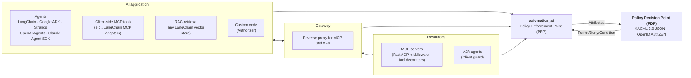

# How it fits: application, gateway, and resources reach the PDP through the SDK (PEP)

The README embeds the rendered `how-it-fits.png`; this file is the editable Mermaid source. Re-export the PNG after changing it.

