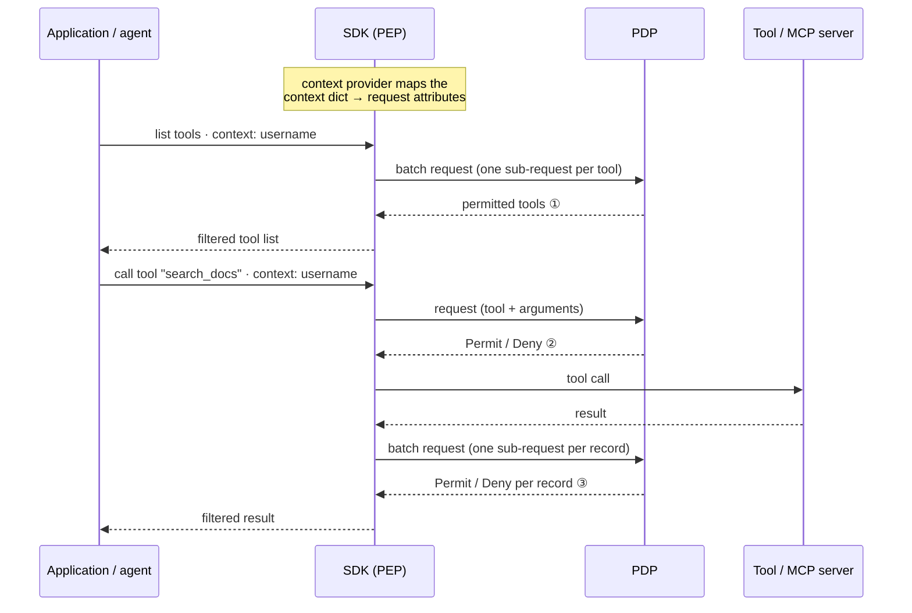
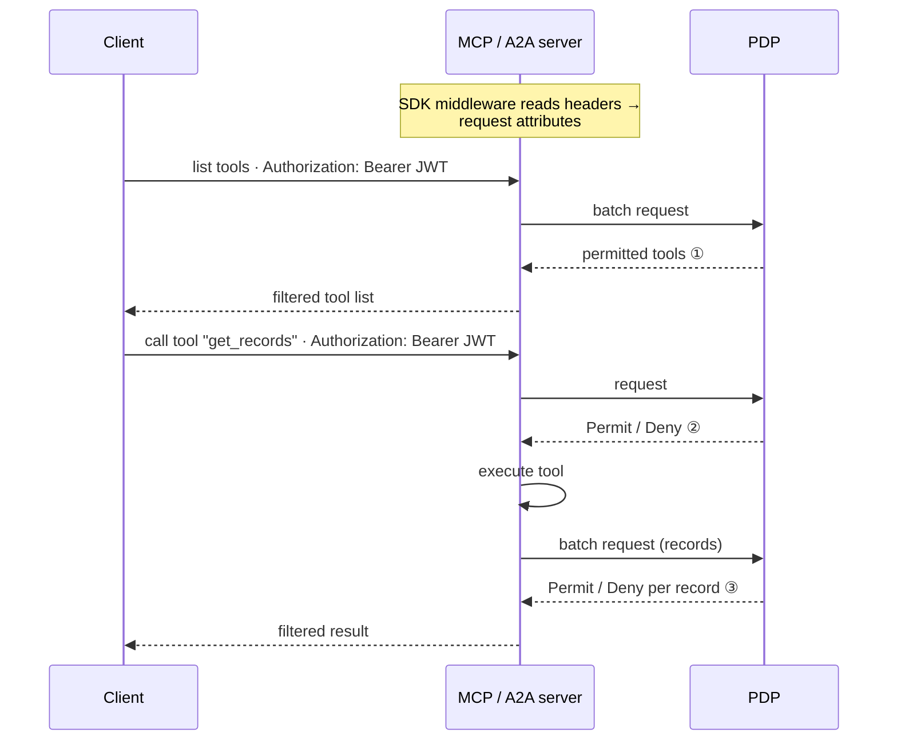
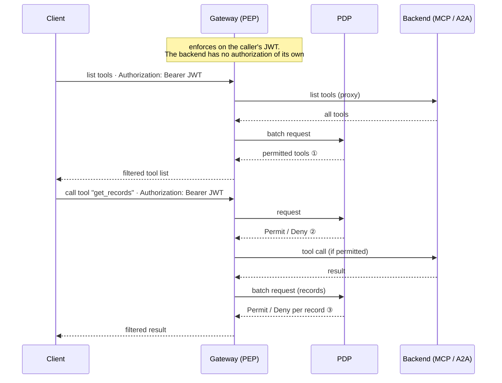

# Architecture

Three deployment shapes, one mechanism. In each, the SDK is the Policy Enforcement Point: it
builds an authorization request from the caller's identity and the thing being attempted, asks
the PDP, and applies the answer. The PDP holds the policy; the SDK never does.

## Client side: agents, `langchain_mcp`, `rag`, `direct`

Identity is a dict or object the application passes at the call site. A
`DefaultClientContextProvider` (or your subclass) turns it into request attributes before each
PDP call.

## Server side: `fastmcp`, `tool_decorator`, `a2a` server

Identity travels in HTTP headers with every request. A `DefaultServerContextProvider` reads
them; the application passes nothing. Headers can be `Authorization: Bearer <JWT>` or any
custom header.

## Gateway: reverse proxy in front of MCP and A2A backends

The out-of-process shape. Clients point only at the gateway; it authorizes every request on the
caller's JWT and forwards permitted traffic to backends that carry no authorization of their
own. For an A2A route it also rewrites the agent card's URL to itself so replies keep routing
through it.

## Retrieval: a reverse query instead of a decision

RAG filtering asks a different question. Instead of "may alice read document X?" for every
candidate, the SDK asks once "under what condition may alice read?", receives a constraint on
the document attributes, and pushes it into the vector store as a native metadata filter. Only
permitted documents come back; retrieval code is unchanged. This needs a PDP that supports
partial evaluation; see [PDP compatibility](configuration.md#pdp-compatibility) and
[rag](integrations/rag.md).

## Where the pieces live

| Package | Role |
|---|---|
| `axiomatics_ai.core` | `AuthZConfig`, `PdpClient`, `Authorizer`, context providers, enforcement helpers, cache, hooks, enrichers, post-invocation strategies. Depends only on httpx, pydantic, cachetools. |
| `axiomatics_ai.<path>` | one adapter per framework, each a thin mapping from that framework's hooks onto the core helpers |
| `axiomatics_ai.gateway` | the reverse proxy: Starlette app composing the `fastmcp` and `a2a` adapters |

[Docs index](README.md)
